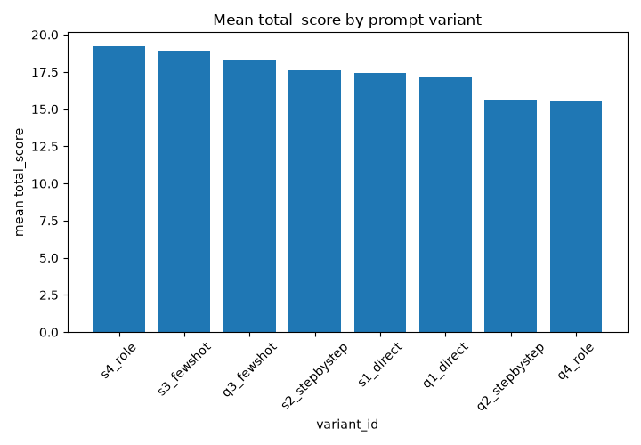

# PromptBench

A small framework for testing prompt variations against Claude, scoring the
outputs against a written rubric, and drawing a conclusion about which prompt
performs best.

## Result summary

160 calls to `claude-haiku-4-5-20251001` (8 prompt variants x 10 test cases x
temperatures 0.0 and 0.7). Few-shot examples and a role prompt won; asking for
step-by-step reasoning made short answers longer and cost relevance and tone.
Full write-up in [`findings.md`](findings.md); data in `results/`.

| Rank | Variant | Task | Mean total (of 20) |
|---|---|---|---|
| 1 | s4_role | summarization | 19.20 |
| 2 | s3_fewshot | summarization | 18.95 |
| 3 | q3_fewshot | qa | 18.35 |
| 4 | s2_stepbystep | summarization | 17.60 |
| 5 | s1_direct | summarization | 17.40 |
| 6 | q1_direct | qa | 17.15 |
| 7 | q2_stepbystep | qa | 15.65 |
| 8 | q4_role | qa | 15.55 |



## Setup

```bash
python3 -m venv .venv && source .venv/bin/activate
pip install -r requirements.txt
cp .env.example .env     # then paste your key after ANTHROPIC_API_KEY=
```

`.env` is git-ignored. The key can also be exported in your shell.

## Workflow

1. **`rubric.md`** - 1-5 anchors for relevance, accuracy, tone and completeness.
2. **`prompts.yaml`** - 8 prompt variants (4 summarization, 4 Q&A). Each changes
   one dimension (direct, step-by-step, few-shot, role) from its baseline.
3. **`test_cases.csv`** - 10 cases per task type (`case_id,input,task_type`).
4. **Run the evaluation:**
   ```bash
   python run_evaluation.py --dry-run     # show the plan, no API calls
   python run_evaluation.py               # 160 calls, capped by --max-calls
   ```
   - Calls every (variant x matching case) at temperature 0.0 and 0.7.
   - Hard-capped by `--max-calls` (default 160). It refuses to start if the plan
     would exceed the cap.
   - Every raw output, including failures, is saved to `results/raw_outputs.json`
     right after each call. Reruns skip recorded runs; `--retry-errors`
     re-attempts failed ones.
   - Prints token counts and estimated cost (`config/pricing.yaml`, approximate).
   - Temperature is sent through `extra_body`, because the SDK's `create()` has no
     `temperature` argument. Some newer models reject it, which is why the model
     under test is Haiku 4.5. Change it with `--model`.
5. **Score every output:**
   ```bash
   python score_results.py                          # interactive prompts
   python score_results.py --scores-file scores.csv # or import a validated CSV
   ```
   The CSV needs `run_id, relevance, accuracy, tone, completeness, scorer_notes`;
   every value must be an integer from 1 to 5.
6. **Analyze:**
   ```bash
   python analyze_results.py
   ```
   Writes to `results/`: `ranked_variants.csv`, `ranked_by_task_type.csv`,
   `consistency_deltas.csv` and `variant_scores_chart.png`.
7. **`findings.md`** - conclusions tied to the numbers above.

## Files

```
promptbench/
├── rubric.md
├── prompts.yaml
├── test_cases.csv
├── lib.py                 # shared loaders and validators
├── config/pricing.yaml    # approximate per-model $/Mtok, for cost logging
├── run_evaluation.py      # evaluation runner
├── score_results.py       # scoring CLI
├── analyze_results.py     # aggregation and chart
├── results/
│   ├── raw_outputs.json
│   ├── scored_results.csv
│   ├── ranked_variants.csv
│   ├── ranked_by_task_type.csv
│   ├── consistency_deltas.csv
│   └── variant_scores_chart.png
├── findings.md
└── README.md
```

## Design Decisions

| Decision | Choice | Why |
|---|---|---|
| Prompt variants | One changed dimension per variant (direct, step-by-step, few-shot, role) against a baseline | Any score difference can be traced to a single change |
| Temperatures | Every variant at both 0.0 and 0.7 | Shows whether a prompt's quality depends on sampling randomness |
| Scoring | Manual 1-5 rubric with fixed anchors, scores validated as integers 1-5 | Rubric anchors are fixed before scoring so they cannot drift to fit results |
| Failed calls | Recorded with `status="error"`, never discarded | Failures stay visible in the data instead of silently shrinking the sample |
| Budget | Hard `--max-calls` cap; the run refuses to start if the plan exceeds it | An API-spending script should not be able to overrun its budget |
| Resumability | Raw output saved after every call; reruns skip recorded runs | A crash or rate limit loses at most one call |
| Model under test | `claude-haiku-4-5-20251001` | Accepts a temperature setting, and is cheap enough for 160 calls (about $0.12) |

## Notes and limitations

- One run per case and temperature, so run-to-run standard deviation is empty and
  the temperature comparison is a difference of means.
- A single scorer applied the rubric; there is no inter-rater check.
- Single model, short inputs; see `findings.md` for more.

## Out of Scope

Automated or LLM-based scoring, multi-model comparison, statistical significance
testing, and repeated runs per case. The framework measures a small, hand-scored
sample; treat the ranking as a starting point for further testing, not a verdict.
